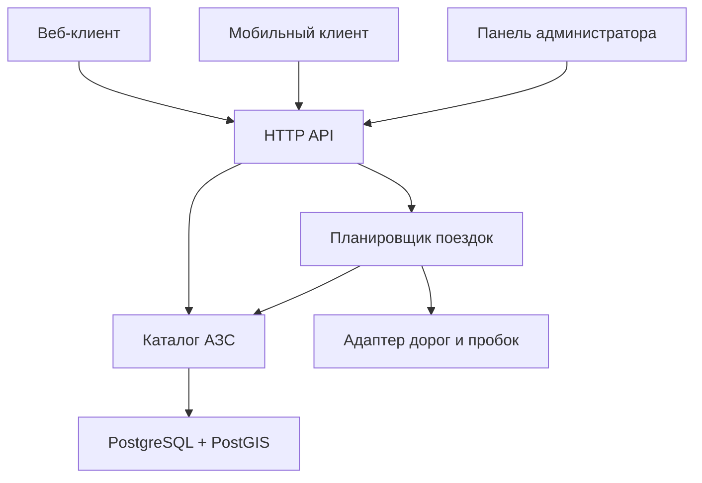

# Архитектура FuelRoute

## Целевая структура



Предлагаемый стек на следующие этапы — API на Python, веб-клиент на TypeScript, мобильный клиент на React Native и хранилище PostgreSQL с PostGIS. Разработку API можно продолжить переносом функций планировщика в FastAPI. Провайдер карты, геокодирования и маршрутов выбирается по проверенному покрытию Ташкента, дорожному трафику, лимитам и разрешённому использованию данных. Ключи серверной интеграции хранятся в окружении.

| Слой | Ответственность |
|---|---|
| Клиенты | Ввод параметров, карта, карточки АЗС, состояния загрузки и ошибок |
| Планировщик | Нормализация единиц, резерв, прямой маршрут, проверка двух участков через АЗС, ранжирование |
| Адаптер | Геокодирование, маршруты, длина, ETA, данные о трафике и их актуальность |
| Каталог | Пространственный поиск, время работы, датированные сведения о наличии |
| Администрирование | Права по ролям, изменения каталога, журнал аудита |

## Поток расчёта

1. Проверить ввод и принадлежность обеих точек городскому полигону. Проверить, что геометрия всех предложенных маршрутов остаётся в полигоне. При отсутствии такого маршрута вернуть отдельную ошибку.
2. Запросить базовый маршрут и доступные альтернативы. Оценить расход каждого маршрута и сопоставить его с остатком и резервом.
3. При дефиците найти в географическом коридоре кандидатов с совместимым топливом. Если поиск по коридору ничего не даёт, расширить область до заданного лимита объезда.
4. Для каждого кандидата запросить дорожные участки А → АЗС и АЗС → Б. Учитывать ETA до АЗС при проверке графика. Для второго участка учитывать расчётное время выезда со станции, если источник поддерживает прогноз на нужный момент.
5. Проверить запас на первом участке, ёмкость на втором и предел объезда. Отсортировать варианты и вернуть показатели маршрута и актуальности данных.

Расстояние до АЗС измеряется по дорожной сети. Близость точки к полилинии используется для предварительного отбора. Для собственного большого графа поиск с ограничением по топливу потребует алгоритма с несколькими недоминируемыми метками времени и расхода. Учебный граф перебирает простые пути в порядке времени и подходит для небольшого набора узлов.

## Данные и API

| Сущность | Поля |
|---|---|
| station | id, name, address, geography, timezone, working_hours, active |
| station_fuel | station_id, fuel_type, availability, observed_at, source |
| admin_user | id, account, role, active |
| station_audit | station_id, actor_id, timestamp, before, after |
| city_boundary | city_id, geometry, source, version |

Пространственный индекс АЗС ускоряет отбор по коридору. Каталог хранит дату наблюдения отдельно от даты редактирования. Изменение и запись аудита выполняются в одной транзакции. Часы работы интерпретируются в Asia/Tashkent.

Первый этап предоставляет `GET /api/network` для схемы и `POST /api/plan` для расчёта. Статусы плана — `enough`, `alternate`, `refuel`, `unreachable`. Ошибка ввода возвращает HTTP 400. План содержит базовый и рассчитанный маршрут, километры, минуты, расход и единицу. Для остановки выдаются ID АЗС, остаток при прибытии и минимальная дозаправка.

В публичном API следующего этапа добавляются городские координаты, полилинии, время обновления данных, ожидаемый остаток в Б и варианты остановки. В панели предвидятся операции чтения и редактирования каталога и просмотра аудита. Ошибка провайдера получает отдельный статус, чтобы отличить её от нехватки топлива.

## Структура при развитии проекта

```text
apps/web/             # Публичный сайт и административные страницы
apps/mobile/          # Android и iOS
services/api/         # HTTP, планировщик, адаптеры и репозитории
db/migrations/        # Схема и индексы
docs/                 # ТЗ, архитектура, методика исследования
```
